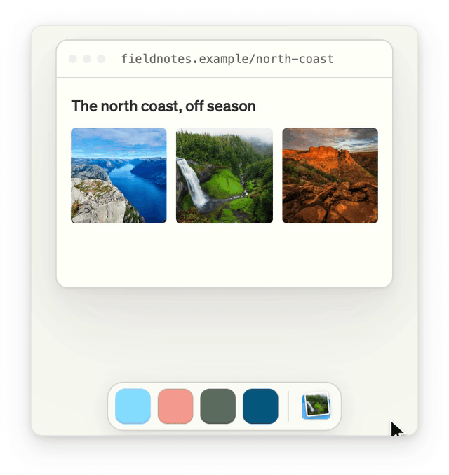

  

<h1 align="center">Nab</h1>

<b>Drag any image to download it.</b>

  Click and hold an image, pull it about an inch, and let go. The file is in your Downloads folder, with no right-click,
  no menu, and no save dialog.

  
  
  

  <a href="https://chromewebstore.google.com/detail/nab/fgigkcbgndamdemjdbhemgndlpmamjje">Add to Chrome</a> ·
  <a href="https://mattdesiena.com/software/nab/">Website</a> ·
  <a href="PRIVACY.md">Privacy</a> ·
  <a href="https://github.com/theinstantwin/nab/releases">Changelog</a> ·
  <a href="#contributing">Contributing</a>

## Features

- Drag any image to save it, no right-click needed
- A blue outline follows your cursor and turns green once you've dragged far enough
- Works on regular images from any site, but not CSS backgrounds, canvas, or video
- Filenames come out clean: `photo.jpg`, not `photo.jpg?w=800&q=75`
- Clicking a linked image still follows the link, as it should
- If a download fails, Nab tells you why instead of failing silently

  <picture>
    <source media="(prefers-color-scheme: dark)" srcset=".github/readme/nab-demo-dark.gif">
    <source media="(prefers-color-scheme: light)" srcset=".github/readme/nab-demo.gif">
    
  </picture>

## Requirements

- Google Chrome or a Chromium-based browser

## Download

Install it from the [Chrome Web Store](https://chromewebstore.google.com/detail/nab/fgigkcbgndamdemjdbhemgndlpmamjje). Every release and its notes are on [Releases](https://github.com/theinstantwin/nab/releases).

## Building

No build step, no dependencies. To run it from source, which takes about a minute:

1. Download [**nab-2.1.0.zip**](https://github.com/theinstantwin/nab/releases/latest) and unzip it. Keep the folder somewhere permanent. Chrome loads the extension from it, so deleting it uninstalls Nab.
2. Open a new tab and go to `chrome://extensions`
3. Turn on the **Developer mode** toggle
4. Click **Load unpacked** and pick the unzipped folder
5. Nab appears in your extensions list. Reload any tabs you already had open.

To update later, download the newer ZIP, replace the folder's contents, and click the refresh icon on Nab's card at `chrome://extensions`.

## About that permission warning

Chrome will say Nab can "read and change all your data on all websites." Every extension that works on any page gets that warning, and it's worth knowing what Nab actually does with it.

Nab watches for you dragging an image and hands that image's address to Chrome's own download manager. That's it. It has no way to send anything anywhere: no analytics, no account, no server, and no permission to store data. The code is right here, and it's two files.

The alternative would be making you click a toolbar button on every page before dragging, which is slower than just right-clicking the image.

## Contributing

Issues and pull requests are welcome.

## License

Nab is licensed under the [MIT License](LICENSE).

Created by <a href="https://mattdesiena.com">Matt DeSiena</a>

